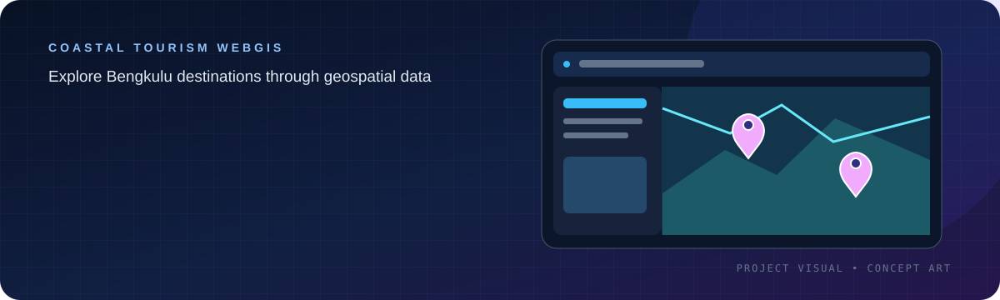
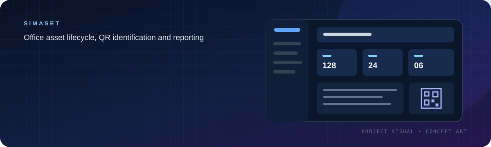
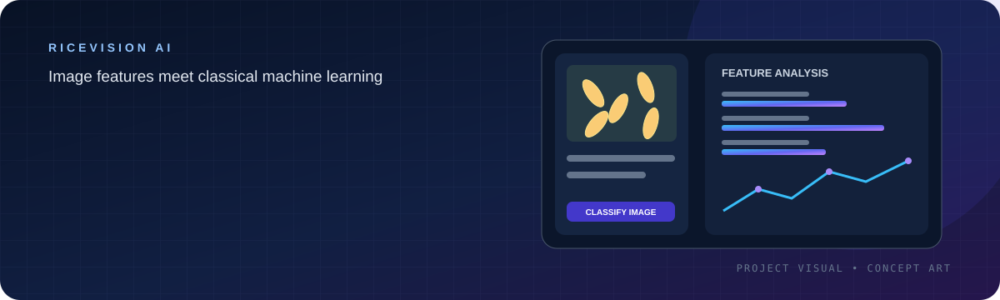
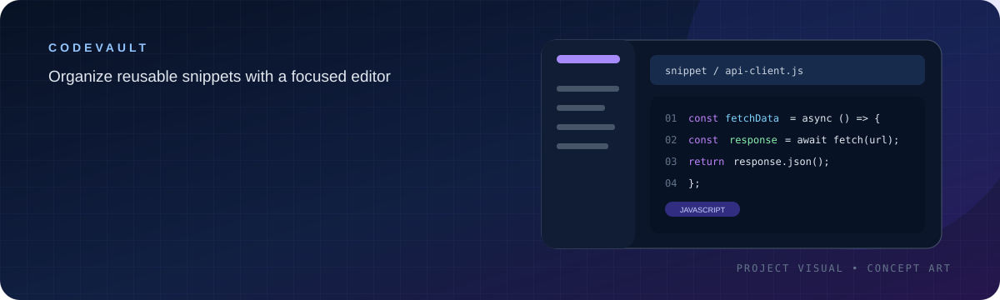
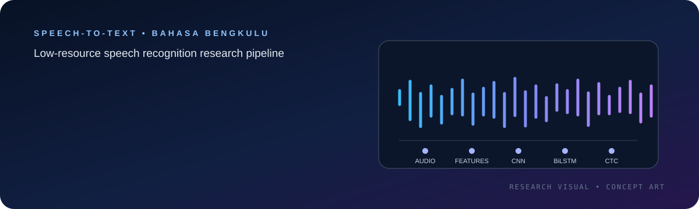
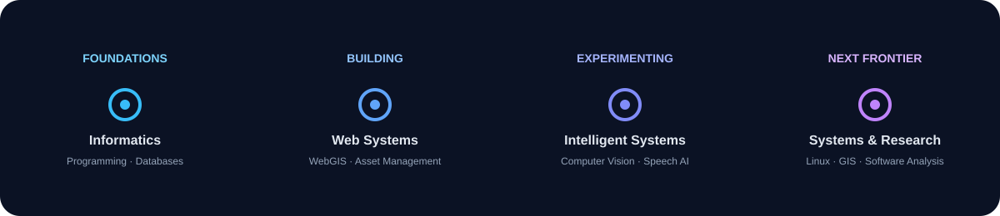

<!-- REFFKI ANDREA PRATAMA | GitHub Profile Portfolio -->

 

### REFFKI ANDREA PRATAMA

**Informatics Student · Software Developer · Technology Explorer**

Universitas Bengkulu — Faculty of Engineering · Bengkulu, Indonesia

  

---

## ✦ 01 / THE PERSON BEHIND THE CODE

<table>
<tr>
<td width="62%" valign="top">

I'm an Informatics student who enjoys turning ideas into working software and understanding the systems behind it.

My interests span **software engineering, computer vision, geospatial technology, and system infrastructure**. I learn by building: explore a problem, design a practical solution, implement it, test it, and keep improving.

I enjoy projects that combine thoughtful engineering with real-world use cases — from mapping local tourism destinations to managing office assets and experimenting with image-based machine learning.

**My working mindset**
- Build for a clear purpose, not just for a tech stack.
- Keep learning by experimenting and documenting.
- Prefer maintainable solutions over unnecessary complexity.
- Stay curious about how software works beneath the interface.

</td>
<td width="38%" valign="top">

### QUICK PROFILE

| | |
|:--|:--|
| 🎓 **Education** | Informatics |
| 🏛️ **University** | Universitas Bengkulu |
| 📍 **Location** | Bengkulu, Indonesia |
| 💻 **Primary focus** | Software Development |
| 🧪 **Research interests** | CV · ML · GIS |
| 🖥️ **Also exploring** | Linux · Systems |

 

</td>
</tr>
</table>

## ✦ 02 / FEATURED WORK

A selection of academic and personal projects. The illustrations below are custom project visuals to make the portfolio easier to scan; they are **not screenshots of running applications**.

<table>
<tr>
<td width="50%" valign="top">

### 🌊 Coastal Tourism WebGIS

**A geospatial tourism information system for destinations around Bengkulu.**

- Destination catalogue and detail pages.
- Interactive Leaflet map and category markers.
- User reviews and star ratings.
- Admin dashboard for destination management.

**Stack:** Laravel 12 · PHP · Leaflet · MySQL · Tailwind CSS

<a href="https://github.com/ReffkiAndreaPratama/Websiste-Peta-Interaktif-Pariwisata-Bengkulu"><strong>↗ SOURCE CODE</strong></a>

</td>
<td width="50%" valign="top">

### 📦 SimAset — Office Asset Management

**A web-based office asset management system developed for RBTV Bengkulu as a practical-work project.**

- Asset and room master data.
- QR-code generation and browser scanning.
- Maintenance tracking and audit logs.
- Excel/CSV import-export and PDF reports.
- Role-based access for system users.

**Stack:** Laravel 12 · PHP · MySQL · JavaScript

<a href="https://github.com/ReffkiAndreaPratama/Project-kp-simaset"><strong>↗ SOURCE CODE</strong></a>

</td>
</tr>
<tr>
<td width="50%" valign="top">

### 🌾 RiceVision AI

**An image-based rice variety classification project comparing classical machine-learning approaches.**

- Image preprocessing and feature extraction.
- Color, texture (GLCM), and shape descriptors.
- SVM and Random Forest model comparison.
- Single-image and batch prediction.
- Streamlit interface and evaluation tools.

**Stack:** Python · OpenCV · scikit-image · scikit-learn · Streamlit

<a href="https://github.com/ReffkiAndreaPratama/Sesi-4---RICE-CLASSIFICATION-AI"><strong>↗ SOURCE CODE</strong></a>

</td>
<td width="50%" valign="top">

### 🔐 CodeVault

**A code-snippet manager for organizing, searching, versioning, and reusing code.**

- Editor with syntax highlighting.
- Tags, collections, and global search.
- Version history, restore, and diff.
- Import/export and optional public sharing.
- Dark mode and keyboard-driven actions.

**Stack:** Laravel 11 · PHP 8.4 · Alpine.js · Tailwind CSS · CodeMirror 6

<a href="https://github.com/ReffkiAndreaPratama/codevault"><strong>↗ SOURCE CODE</strong></a>

</td>
</tr>
<tr>
<td width="50%" valign="top">

### 🎙️ Speech-to-Text Bahasa Bengkulu

**A research prototype exploring speech recognition for a low-resource regional language.**

- Audio preprocessing and dataset preparation.
- CNN–BiLSTM–CTC model pipeline.
- Training and evaluation using WER and CER.
- Exploration of local-language speech technology.

**Status:** Research pipeline and tooling are in development; reliable transcription depends on suitable dataset collection and model training.

**Stack:** Python · Deep Learning · Audio Processing

<a href="https://github.com/ReffkiAndreaPratama/speachtotext"><strong>↗ SOURCE CODE</strong></a>

</td>
<td width="50%" valign="top">

### 🧭 More Experiments & Repositories

**The workshop is always open.**

I also use GitHub to document smaller experiments, coursework, utilities, and ideas as they evolve.

Current exploration areas:
- Backend APIs and database design.
- Reverse engineering and software analysis.
- Linux administration and self-hosting.
- GIS workflows and spatial data.
- Automation and developer tooling.

<a href="https://github.com/ReffkiAndreaPratama?tab=repositories"><strong>↗ BROWSE ALL REPOSITORIES</strong></a>

</td>
</tr>
</table>

## ✦ 03 / TECHNOLOGY TOOLKIT

**WEB & APPLICATION DEVELOPMENT**

  

**DATA, MACHINE LEARNING & COMPUTER VISION**

  

**SYSTEMS, GIS & DEVELOPER TOOLS**

  

Technologies shown reflect a mix of hands-on project use, coursework, and ongoing exploration — not a ranking of proficiency.

## ✦ 04 / MY DEVELOPER JOURNEY

<table>
<tr>
<td width="33%" valign="top">

**⌘ SOFTWARE ENGINEERING**

- Backend architecture
- REST API development
- Database modelling
- Application security

</td>
<td width="33%" valign="top">

**◉ INTELLIGENT SYSTEMS**

- Image preprocessing
- GLCM and shape features
- Machine-learning models
- Speech recognition

</td>
<td width="33%" valign="top">

**⌁ SYSTEMS & SPATIAL**

- Linux services
- Self-hosted infrastructure
- GIS and spatial analysis
- API and binary analysis

</td>
</tr>
</table>

## ✦ 05 / GITHUB ACTIVITY

  

  

  

Statistics and graphs are generated by third-party services. They may occasionally be unavailable, and language distribution is not a measure of skill level.

## ✦ 06 / BEYOND THE SCREEN

🎨 Sketching &nbsp; · &nbsp; 🎮 Gaming &nbsp; · &nbsp; 🎬 Movies &nbsp; · &nbsp; 🖥️ PC Hardware

---

## ✦ 07 / LET'S CONNECT

**Have an idea, want to collaborate, or just want to talk tech? Feel free to reach out.**

  

**REFFKI ANDREA PRATAMA** · Learn continuously. Build thoughtfully.

