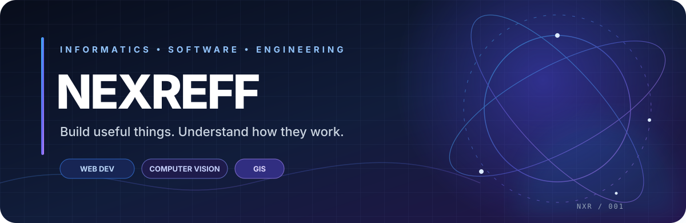

<!-- NEXREFF | Designed developer profile -->

 

### REFFKI ANDREA PRATAMA

**Informatics Student · Software Developer · Technology Explorer**

Universitas Bengkulu — Faculty of Engineering · Bengkulu, Indonesia

 

  

---

## ◈ 01 — ABOUT

<table>
<tr>
<td width="62%" valign="top">

I'm an Informatics student who enjoys turning ideas into working software and understanding the systems behind it.

My work moves across application development, computer vision, geospatial technology, and system infrastructure. I learn by building projects, testing approaches, and improving what I make.

**What drives me**
- Creating useful tools and applications.
- Exploring how software and systems behave.
- Applying computing concepts to real problems.
- Learning new technologies through hands-on work.

</td>
<td width="38%" valign="top">

**PROFILE SNAPSHOT**

| | |
|:--|:--|
| 🎓 Education | Informatics |
| 🏛️ University | Universitas Bengkulu |
| 📍 Location | Bengkulu, Indonesia |
| 💻 Main focus | Software Development |
| 🧪 Exploring | CV · GIS · Linux |

</td>
</tr>
</table>

## ◈ 02 — FEATURED WORK

Selected academic and personal projects. Each card links directly to its source repository.

<table>
<tr>
<td width="50%" valign="top">

<h3>🌊 Coastal Tourism WebGIS</h3>

Interactive geographic information system for discovering coastal tourism destinations in Bengkulu.

**Core:** Interactive map · Destination data · Geographic visualization

**Stack:** Laravel · Leaflet · MySQL

<a href="https://github.com/ReffkiAndreaPratama/Websiste-Peta-Interaktif-Pariwisata-Bengkulu">↗ Explore repository</a>

</td>
<td width="50%" valign="top">

<h3>📦 Office Asset Management</h3>

Web-based office asset management system developed during practical fieldwork.

**Core:** Asset inventory · Incoming/outgoing records · Reporting

**Stack:** Laravel · PHP · MySQL

<a href="https://github.com/ReffkiAndreaPratama/Project-kp-simaset">↗ Explore repository</a>

</td>
</tr>
<tr>
<td width="50%" valign="top">

<h3>🌾 Rice Image Classification</h3>

Image classification experiment using preprocessing, texture and shape descriptors, and machine learning.

**Core:** Image processing · Feature extraction · Classification

**Stack:** Python · OpenCV · scikit-learn

<a href="https://github.com/ReffkiAndreaPratama/Sesi-4---RICE-CLASSIFICATION-AI">↗ Explore repository</a>

</td>
<td width="50%" valign="top">

<h3>🧠 TechDiagnose AI Prototype</h3>

Adaptive learning prototype for PC and laptop troubleshooting.

**Core:** Learning paths · Assessments · Exercises · AI tutor concept

**Focus:** Adaptive Learning · Web Development · AI

<a href="https://github.com/ReffkiAndreaPratama/TechDiagnoseAIPrototype">↗ Explore repository</a>

</td>
</tr>
<tr>
<td width="50%" valign="top">

<h3>🔐 CodeVault</h3>

Project exploring secure file sharing and practical application security.

<a href="https://github.com/ReffkiAndreaPratama/codevault">↗ Explore repository</a>

</td>
<td width="50%" valign="top">

<h3>🎙️ Speech to Text</h3>

Experiment focused on speech recognition and audio-to-text conversion.

<a href="https://github.com/ReffkiAndreaPratama/speachtotext">↗ Explore repository</a>

</td>
</tr>
</table>

## ◈ 03 — TECHNOLOGY STACK

**APPLICATION DEVELOPMENT**

  

**DATA · COMPUTER VISION · DATABASE**

  

**SYSTEMS · TOOLS · GEOINFORMATICS**

  

Tools shown represent a mix of project use, coursework, and ongoing exploration—not a proficiency ranking.

## ◈ 04 — CURRENT EXPLORATION

<table>
<tr>
<td width="33%" valign="top">

**01 / SOFTWARE**

- Backend architecture
- REST API design
- Database-driven apps
- Application security

</td>
<td width="33%" valign="top">

**02 / INTELLIGENCE**

- Image preprocessing
- GLCM & shape features
- Machine learning
- Model evaluation

</td>
<td width="33%" valign="top">

**03 / SYSTEMS**

- Linux services
- Self-hosted tools
- GIS workflows
- API & binary analysis

</td>
</tr>
</table>

## ◈ 05 — GITHUB INSIGHTS

  

  

Stats and trophies are generated by third-party services. Availability and displayed metrics may vary.

## ◈ 06 — BEYOND THE TERMINAL

🎨 **Sketching** &nbsp; · &nbsp; 🎮 **Gaming** &nbsp; · &nbsp; 🎬 **Movies** &nbsp; · &nbsp; 🖥️ **PC Hardware**

---

## ◈ 07 — CONNECT

**Have an idea, project, or opportunity? Let's connect.**

  

