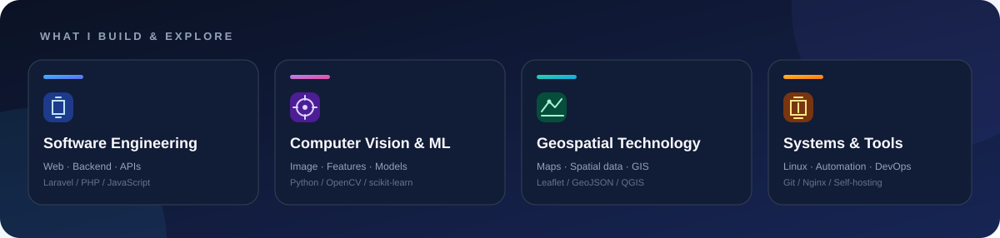
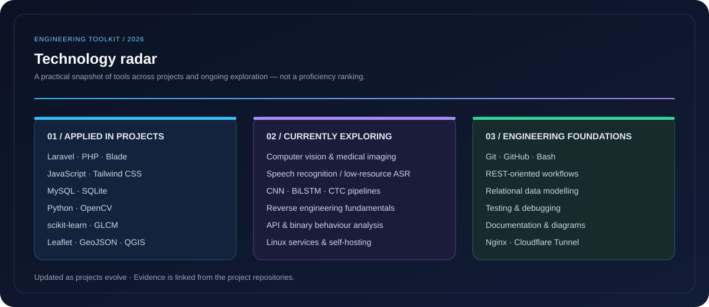

<!-- REFFKI ANDREA PRATAMA | Visual Developer Portfolio -->

 
# REFFKI ANDREA PRATAMA
**INFORMATICS STUDENT · SOFTWARE DEVELOPER · TECH EXPLORER**
Universitas Bengkulu · Faculty of Engineering · Indonesia

  

<a href="#about">ABOUT</a> &nbsp;·&nbsp;
<a href="#featured-work">PROJECTS</a> &nbsp;·&nbsp;
<a href="#toolkit">TOOLKIT</a> &nbsp;·&nbsp;
<a href="#journey">JOURNEY</a> &nbsp;·&nbsp;
<a href="#activity">ACTIVITY</a> &nbsp;·&nbsp;
<a href="#latest">LATEST</a> &nbsp;·&nbsp;
<a href="#connect">CONTACT</a>

---

## 01 / A LITTLE ABOUT ME

<table>
<tr>
<td width="58%" valign="middle">
I like turning ideas into practical software. My work moves between **web development, computer vision, geospatial applications, and systems**.

Currently studying Informatics at Universitas Bengkulu. I learn by building, testing, breaking things, and improving them.

**Curious by nature. Practical by design.**
</td>
<td width="42%" valign="middle">

</td>
</tr>
</table>

## 02 / SELECTED WORK

A few projects I have been building. Project artwork is illustrative, not a screenshot of a live application.

<table>
<tr>
<td width="50%" valign="top">

### 🌊 Coastal Tourism WebGIS
An interactive tourism information system for Bengkulu destinations.
Laravel · Leaflet · MySQL · Tailwind
<a href="https://github.com/ReffkiAndreaPratama/Websiste-Peta-Interaktif-Pariwisata-Bengkulu"><strong>VIEW PROJECT ↗</strong></a>
</td>
<td width="50%" valign="top">

### 📦 SimAset
Office asset management for RBTV Bengkulu: QR identification, maintenance, and reporting.
Laravel · PHP · MySQL · Chart.js
<a href="https://github.com/ReffkiAndreaPratama/Project-kp-simaset"><strong>VIEW PROJECT ↗</strong></a>
</td>
</tr>
<tr>
<td width="50%" valign="top">

### 🌾 RiceVision AI
Rice image classification with color, texture, and shape features.
Python · OpenCV · GLCM · scikit-learn
<a href="https://github.com/ReffkiAndreaPratama/Sesi-4---RICE-CLASSIFICATION-AI"><strong>VIEW PROJECT ↗</strong></a>
</td>
<td width="50%" valign="top">

### 🔐 CodeVault
A code-snippet library with search, collections, editor, and version history.
Laravel · Alpine.js · Tailwind · CodeMirror
<a href="https://github.com/ReffkiAndreaPratama/codevault"><strong>VIEW PROJECT ↗</strong></a>
</td>
</tr>
<tr>
<td width="50%" valign="top">

### 🎙️ Speech-to-Text Bengkulu
Exploring low-resource speech recognition with a CNN–BiLSTM–CTC pipeline.
Python · Audio · Deep Learning
<a href="https://github.com/ReffkiAndreaPratama/speachtotext"><strong>VIEW PROJECT ↗</strong></a>
</td>
<td width="50%" valign="middle" align="center">
### MORE IN THE WORKSHOP
**Experiments · Utilities · Open source**

New ideas are always in progress.
</td>
</tr>
</table>

## 03 / MY TOOLKIT

**WEB & APP DEVELOPMENT**

  
**DATA · AI · COMPUTER VISION**

  
**SYSTEMS · GIS · DEVELOPER TOOLS**

  

<strong>✦ Explore my technology radar</strong>

 

## 04 / HOW I GROW

<table>
<tr>
<td width="33%" align="center">**BUILD** Web apps Backend APIs</td>
<td width="33%" align="center">**EXPLORE** Computer vision Machine learning GIS</td>
<td width="33%" align="center">**IMPROVE** Linux Automation Software analysis</td>
</tr>
</table>

<strong>What I am exploring now</strong>

 
- Computer vision and medical-image analysis.
- Low-resource speech recognition.
- Reverse engineering fundamentals and API behaviour.
- Linux services, self-hosting, and deployment.
- Geospatial data and interactive mapping.

## 05 / GITHUB ACTIVITY

  

  

Third-party statistics may occasionally be unavailable. Language distribution is not a measure of proficiency.

## 06 / FRESH FROM THE WORKSHOP

Automatically refreshed daily by GitHub Actions.

<!-- RECENT_REPOSITORIES_START -->
| Repository | Language | Updated |
|:--|:--:|:--:|
| [flood-detection-esp32-wokwi](https://github.com/ReffkiAndreaPratama/flood-detection-esp32-wokwi) | C++ | 2026-11-12 |
| [industrialguard-esp32-wokwi](https://github.com/ReffkiAndreaPratama/industrialguard-esp32-wokwi) | C++ | 2026-11-11 |
| [awesome-reverse-engineering](https://github.com/ReffkiAndreaPratama/awesome-reverse-engineering) | JavaScript | 2026-11-09 |
| [Archon](https://github.com/ReffkiAndreaPratama/Archon) | Rust | 2026-11-09 |
| [nexdownload](https://github.com/ReffkiAndreaPratama/nexdownload) | Rust | 2026-11-09 |
<!-- RECENT_REPOSITORIES_END -->

## 07 / EXPLORE MORE

<strong>Repository policies & documentation</strong>

 
- [Professional profile](docs/PROFILE.md)
- [Quality standards](docs/QUALITY_STANDARDS.md)
- [Automation guide](docs/AUTOMATION.md)
- [Security policy](SECURITY.md)
- [Code of Conduct](CODE_OF_CONDUCT.md)
- [Changelog](CHANGELOG.md)

## 08 / LET'S CONNECT

**Have an idea or want to build something together?**

  

**LEARN · BUILD · IMPROVE**
Reffki Andrea Pratama · Bengkulu, Indonesia

